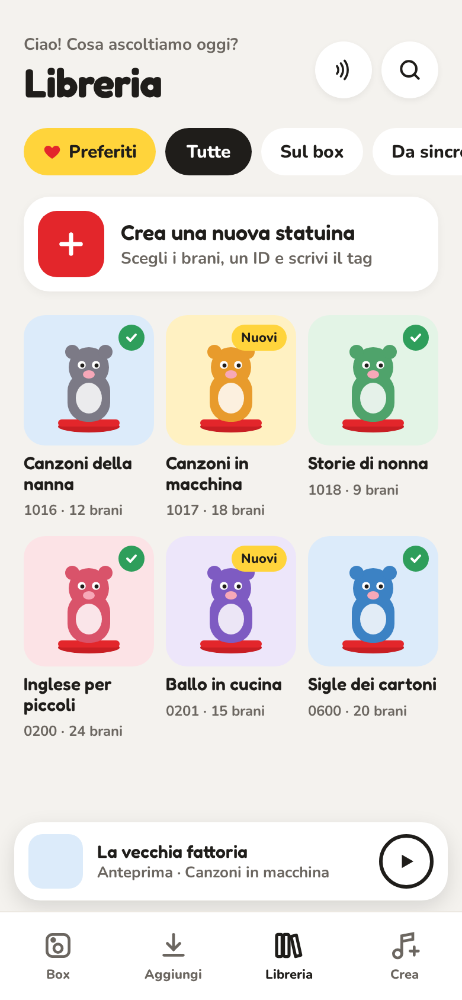
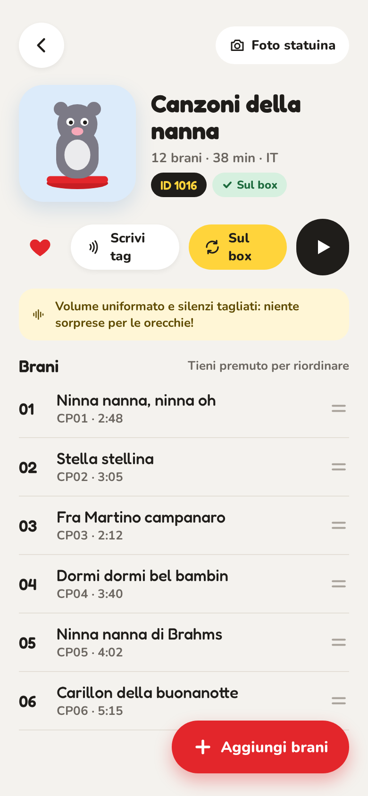
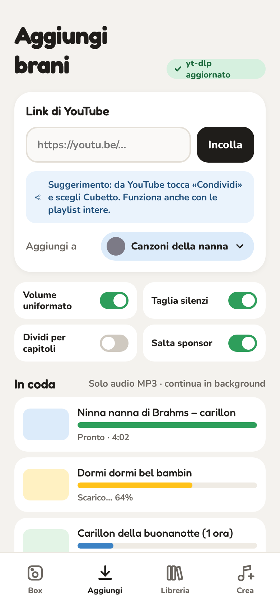
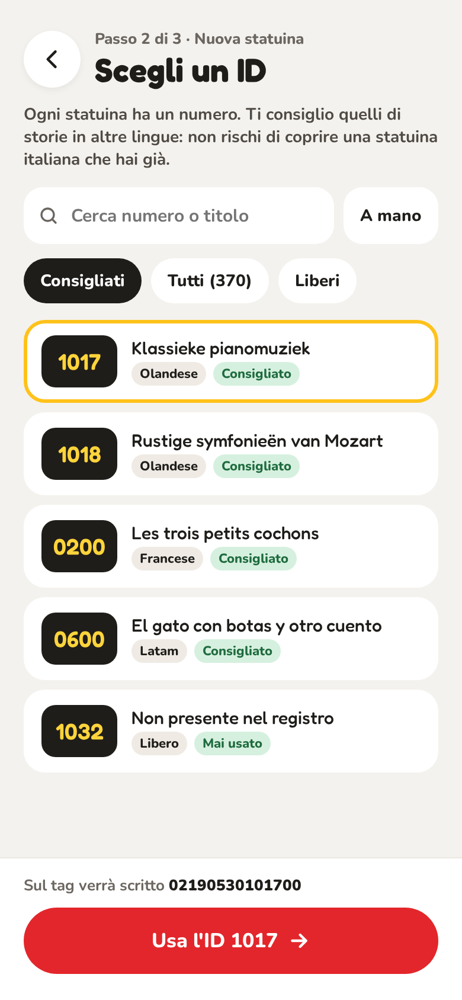
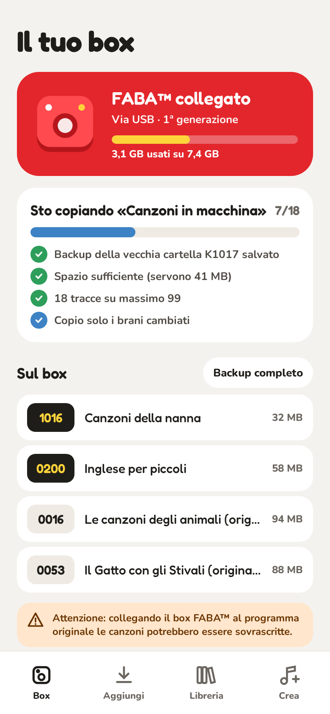
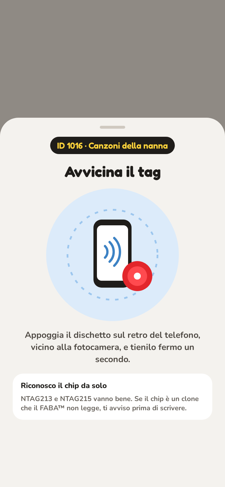

<div align="center">

[](README.md)
[](README.it.md)


# Cubetto

**Statuine personalizzate per il FABA™ di prima generazione, a partire da YouTube o dai tuoi file audio.**


🌍 **App disponibile in:** italiano · English · español · català · français · Nederlands

</div>

> [!WARNING]
> **Versione beta.** Il formato dei file è identico a quello di myfaba-hacks ed è stato provato su un
> FABA™ di prima generazione, ma non su tutti i box. Prima di copiare, l'app fa il backup delle cartelle che
> sovrascrive, ma la usi a tuo rischio.

## 🙏 Ringraziamenti

Cubetto si basa sul lavoro del progetto originale **[myfaba-hacks](https://github.com/wansors/myfaba-hacks)**
di [wansors](https://github.com/wansors) e dei suoi contributori: da lì vengono l'algoritmo di cifratura dei
file MKI, il formato dei tag NFC e il registro degli ID delle statuine. Cubetto riproduce in un'app Android
quello che fa `redele.py` per il FABA™ di prima generazione. Grazie!

**Il flusso:** link o file → MP3 → playlist → formato FABA™ con l'ID scelto → copia via USB sul box → scrittura del tag NFC.

## 📑 Indice

- [🛡️ No alla pirateria](#️-no-alla-pirateria)
- [📱 Schermate](#-schermate)
- [✨ Funzioni](#-funzioni)
- [🏷️ Tag NFC e statuine fai da te](#️-tag-nfc-e-statuine-fai-da-te)
- [🎧 Formato dei brani](#-formato-dei-brani)
- [🧰 Requisiti](#-requisiti)
- [🛠️ Build](#️-build)
- [🗂️ Struttura del progetto](#️-struttura-del-progetto)
- [⚖️ Marchi e avvertenze](#️-marchi-e-avvertenze)
- [📄 Licenza](#-licenza)

## 🛡️ No alla pirateria

> [!IMPORTANT]
> **Cubetto non decifra i file del FABA™, e di proposito.** L'app sa solo *scrivere* i tuoi brani nel formato del box:
> non legge, non converte e non esporta l'audio delle statuine originali, per non favorire in alcun modo la pirateria.
>
> Lo sviluppatore non sostiene alcuna forma di pirateria dei contenuti originali FABA™. Le statuine e le storie
> originali hanno una qualità (voci, musiche, illustrazioni, cura editoriale) che non è nemmeno paragonabile a
> quello che si può creare con Cubetto. **Cubetto è solo uno strumento per aggiungere ciò che le statuine originali
> non offrono**, come le canzoni preferite di casa o le registrazioni dei nonni: non le sostituisce.
> Se ti piace il FABA™, sostieni chi lo realizza acquistando le statuine originali.

## 📱 Schermate

<table>
  <tr>
    <td align="center"><br><b>Libreria</b></td>
    <td align="center"><br><b>Statuina</b></td>
    <td align="center"><br><b>Aggiungi brani</b></td>
  </tr>
  <tr>
    <td align="center"><br><b>Scegli un ID</b></td>
    <td align="center"><br><b>Box USB</b></td>
    <td align="center"><br><b>Tag NFC</b></td>
  </tr>
</table>

<sub>Immagini dai mockup in <code>docs/mockup/</code>: l'app vera può differire nei dettagli.</sub>

## ✨ Funzioni

### 🎵 Brani
- **Da YouTube**: incolla un link oppure usa *Condividi* dall'app YouTube. Le playlist diventano più brani.
- **Dal dispositivo**: MP3, M4A, OPUS, WAV e anche video, di cui si prende solo l'audio.
- **Opzioni**: volume uniformato (`loudnorm`), taglio dei silenzi, divisione per capitoli, SponsorBlock, mono.
- **Download in background** con notifica.
- **yt-dlp sempre aggiornato**: viene scaricato dalle release GitHub tramite
  [youtubedl-android](https://github.com/JunkFood02/youtubedl-android).
  - Il controllo avviene al massimo una volta al giorno, e scarica solo se c'è una versione nuova.
  - Si può forzare da *Impostazioni → Controlla ora*.

### 🧸 Statuine
- Nome, colore, foto e preferiti.
- Brani riordinabili con il trascinamento e lettore audio integrato.
- **Selettore ID** basato sul registro [`TAGS.md` di myfaba-hacks](https://github.com/wansors/myfaba-hacks/blob/main/TAGS.md),
  incluso nell'app e aggiornabile da GitHub.
  - **Consigliati**: gli ID di statuine vendute in lingue *diverse* da quella dell'app, più gli ID liberi.
  - La scelta resta sempre libera.
  - L'app avvisa se l'ID copre una statuina della tua lingua o un'altra tua statuina.
- **Export/import** in JSON: contiene solo i link, l'audio si riscarica.

### 🔌 Box via USB OTG
- Accesso con [libaums](https://github.com/magnusja/libaums), senza root.
- Collegando il box l'app si apre e copia da sola le statuine modificate.
- Lettura veloce: le cartelle vengono lette direttamente dal FAT32 e compaiono man mano.
- **Backup** della cartella prima di sovrascriverla, con ripristino.
- Controlla lo spazio libero e il limite di 99 tracce, e copia solo i brani cambiati.
- Espulsione sicura come dal computer: la cache del box viene scritta e il supporto espulso.

### 📡 NFC
- **Scrittura** del testo `02190530{ID}00` nella posizione esatta letta dal box (pagina 7 byte 2 → pagina 10 byte 3).
  - Funziona su NTAG203/213/215/216, e il tag viene riletto per verifica.
  - Un riquadro **Aiuto** spiega quali tag comprare e come costruire una statuina.
- **Lettura** di una statuina con il riconoscimento del suo ID, e copia su un tag vuoto.
- Avviso per i chip clone non NXP (UID `1D…`/`FF…`).

## 🏷️ Tag NFC e statuine fai da te

**Tag consigliati:** NTAG213 o NTAG215 originali NXP. Molti cloni economici non vengono letti dal FABA™
(vedi [FAQ_TAGS.md](https://github.com/wansors/myfaba-hacks/blob/main/FAQ_TAGS.md)). Questi funzionano:

- [Amazon IT](https://www.amazon.it/dp/B07Q7FZDSC)
- [Amazon ES](https://www.amazon.es/dp/B07Q7FZDSC)
- [Amazon DE](https://www.amazon.de/gp/product/B07Q43PXMR/)

**Statuine fai da te:** basta ritagliare un pezzo di cartone e incollarci sotto il tag, oppure stampare una base
con la stampante 3D:

- [Base per statuine FABA™](https://www.printables.com/model/1378409-base-template-for-faba-audioplayer-figurines/files)
- [Disco FABA™ con cornice per foto](https://www.printables.com/model/1876485-faba-disc-with-photoframe/comments/3668118)

## 🎧 Formato dei brani

| Passaggio | Dettaglio |
|---|---|
| 🎚️ Conversione | Ogni sorgente passa per **lo stesso comando ffmpeg**: prima traccia audio, filtri, MP3 CBR joint stereo 44,1 kHz (96 kbps, 128 kbps senza mono) |
| 🏷️ Tag | Identici byte per byte a `redele.py` di myfaba-hacks: ID3v2.4 con il solo titolo `K{ID}CP{NN}` (UTF-8) e il padding di mutagen |
| 🎼 Audio | Copiato così com'è dopo la conversione, senza altre modifiche |
| 🔐 Cifratura | Rotazione di 3 bit e XOR con la chiave `30 05 19 20` |
| 📁 Percorso | `MKI01/K{ID}/CPnn.MKI`, con veri nomi 8.3 e attributo ARCHIVE come in una copia da PC |

## 🧰 Requisiti

- 📱 Android 8.0+ (API 26), solo **arm64-v8a**.
- 🔌 Un cavo o adattatore **USB OTG**: il FABA™ di prima generazione si presenta come una chiavetta USB.
- 🏷️ Tag **NTAG213/NTAG215** originali NXP (vedi [sopra](#️-tag-nfc-e-statuine-fai-da-te)).

## 🛠️ Build

```bash
./gradlew testDebugUnitTest assembleDebug
# APK: app/build/outputs/apk/debug/app-debug.apk
```

- **Release firmata**: `./gradlew assembleRelease` firma l'APK con la chiave indicata in
  `~/.cubetto-signing/keystore.properties` (o nel file della variabile `CUBETTO_KEYSTORE`), con
  `storeFile`, `storePassword`, `keyAlias` e `keyPassword`. Senza quel file l'APK di release non è firmato.
- Le traduzioni si modificano in `tools/strings.py`, poi si rigenerano con `python3 tools/strings.py`.
- Per confrontare i brani con quelli originali del box:
  `FABA_ORIGINAL_DIR=/percorso/K0016 ./gradlew testDebugUnitTest`.
- Per confrontarli con una cartella creata da `redele.py` (`in_k1000/` con gli MP3, `out_k1000/K1000/` con i .MKI):
  `MYFABA_DIR=/percorso ./gradlew testDebugUnitTest`.

## 🗂️ Struttura del progetto

| Percorso | Contenuto |
|---|---|
| `faba/` | cifratura MKI, tag ID3, frame MP3, layout del tag NFC, registro ID e suggerimenti |
| `ytdlp/` | yt-dlp, conversione ffmpeg, worker dei download |
| `usb/` | accesso al box, lettura FAT32, scrittura delle statuine, backup, ripristino ed espulsione |
| `nfc/` | lettura e scrittura dei tag in reader mode |
| `playback/` | lettore audio (Media3) |
| `data/` | database Room e impostazioni |
| `ui/` | schermate Compose (Libreria, Statuina, Aggiungi, Crea/Scegli ID, Box, Impostazioni) |

## ⚖️ Marchi e avvertenze

- FABA™ e myFABA™ sono marchi dei rispettivi titolari (FABA S.r.l.).
- Cubetto è un progetto indipendente: non è affiliato, sponsorizzato né approvato da FABA S.r.l.
- I nomi delle statuine sono citati solo per identificarne l'ID.
- ⛔ Solo per il FABA™ di prima generazione (offline). **Non supporta FABA+.**
- Usa Cubetto solo con contenuti che hai il diritto di scaricare e ascoltare.

## 📄 Licenza

GPL-3.0, come [myfaba-hacks](https://github.com/wansors/myfaba-hacks), da cui deriva l'algoritmo di cifratura,
e come youtubedl-android. Font Fredoka e Nunito sotto SIL Open Font License.
